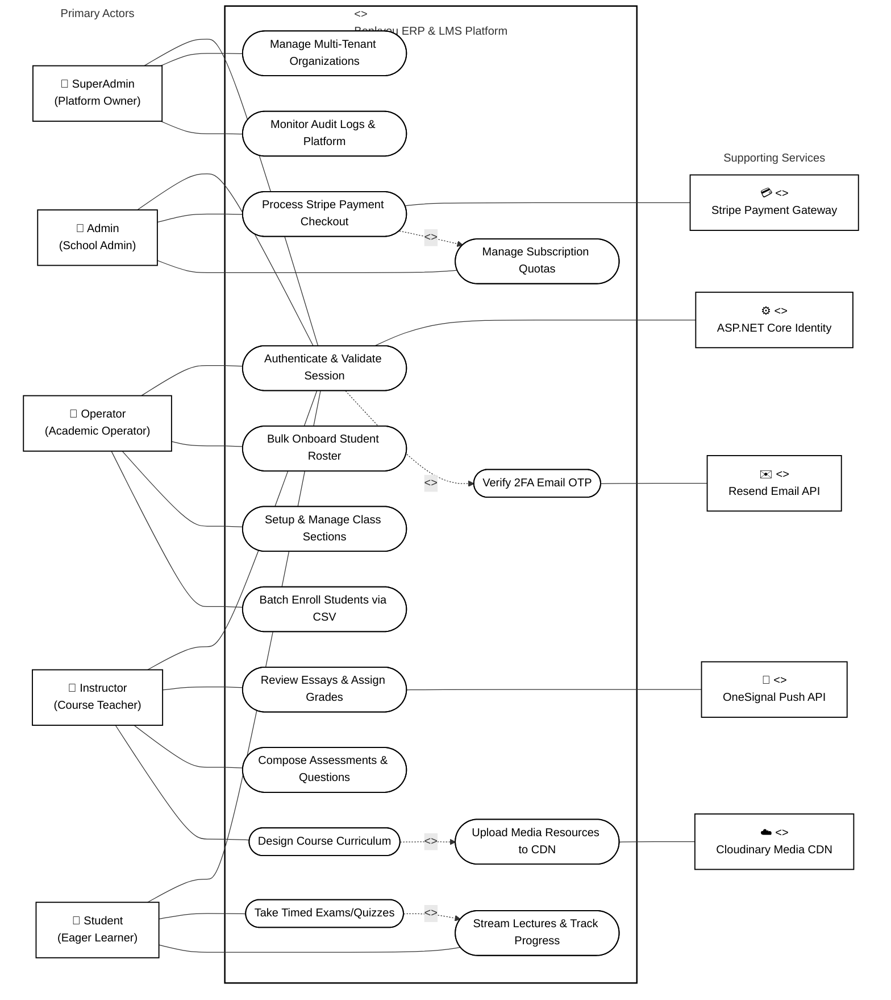

# Benkyou ERP & LMS - UML Use Case Diagram & System Architectural Description

## 1. System Overview & Scope

The **Benkyou Web ERP & LMS Platform** is an enterprise-grade, multi-tenant Educational Resource Planning (ERP) and Learning Management System (LMS). The system is engineered to streamline institutional operations, academic admissions, curriculum design, timed student evaluations, automated and manual grading, and multi-tenant subscription billing.

The UML Use Case Diagram encapsulates the interaction boundaries between the system's **5 Primary Actors**, the **Central System Boundary**, and **5 Supporting External API Services**.

---

## 2. Visual UML Use Case Diagram

---

## 3. Detailed Use Case Description & Actor Breakdown

### 3.1. Primary Actors Description

1. **SuperAdmin (Platform Owner & System Administrator)**
   - **Role**: Oversees the entire multi-tenant infrastructure, provisions system seed data, manages organizational tenants, and monitors platform-wide security audit trails in real-time.
   - **Key Use Cases**: `Monitor Audit Logs & Platform`, `Manage Multi-Tenant Organizations`, `Authenticate & Validate Session`, `Verify 2FA Email OTP`.

2. **Admin (School / Institutional Administrator)**
   - **Role**: Manages tenant-level configurations, institutional profile branding, subscription tier management, and coordinates plan billing upgrades via Stripe Checkout.
   - **Key Use Cases**: `Manage Subscription Quotas`, `Process Stripe Payment Checkout`, `Authenticate & Validate Session`.

3. **Operator (Academic Registrar & Operations Manager)**
   - **Role**: Handles high-volume administrative onboarding, creates class sections, sets section capacity limits, assigns instructors, and bulk-enrolls student rosters using spreadsheet matching.
   - **Key Use Cases**: `Batch Enroll Students via CSV`, `Setup & Manage Class Sections`, `Bulk Onboard Student Roster`.

4. **Instructor (Course Educator & Teacher)**
   - **Role**: Designs curriculum modules, uploads lecture videos and reading materials to Cloudinary CDN, composes assessment question banks, sets exam timers, and reviews/grades student essay submissions.
   - **Key Use Cases**: `Design Course Curriculum`, `Upload Media Resources to CDN`, `Compose Assessments & Questions`, `Review Essays & Assign Grades`.

5. **Student (Learner)**
   - **Role**: Accesses enrolled course player viewports, streams lecture media, marks progress milestones, completes timed exams under countdown constraints, and reviews feedback scorecards.
   - **Key Use Cases**: `Stream Lectures & Track Progress`, `Take Timed Exams/Quizzes`.

---

### 3.2. Supporting External API Services Description

1. **ASP.NET Core Identity & JWT Authentication Provider**
   - Handles role-based access control, cryptographic token signing (`System.IdentityModel.Tokens.Jwt`), and PBKDF2/BCrypt password verification across all authentication workflows.

2. **Resend Email API Services (`ResendClient` SDK)**
   - Delivers transactional emails, account setup verification links, and 6-digit Multi-Factor Authentication (2FA) OTP codes for SuperAdmin login validation.

3. **Stripe Payment Gateway API (`Stripe.net` SDK)**
   - Manages customer provisioning (`v1/customers`), generates Hosted Checkout Sessions (`v1/checkout/sessions`), and processes HMAC-SHA256 signed webhooks (`checkout.session.completed`) for plan upgrades.

4. **Cloudinary Media CDN API (`CloudinaryDotNet` SDK)**
   - Direct cloud binary upload and CDN distribution service for lecture videos (`.mp4`), PDFs, slide decks, and profile images.

5. **OneSignal Push Notification API (`OneSignalApi` SDK)**
   - Web push notification service delivering real-time browser alerts to students when course enrollments are processed or grades are published.

---

## 4. Use Case Execution Relationships & Dependencies

* **`Authenticate & Validate Session` `<<include>>` `Verify 2FA Email OTP`**:
  Logging in as a SuperAdmin mandatory includes a 6-digit Multi-Factor Authentication (2FA) challenge sent via the Resend Email API before a full JWT bearer token is issued.

* **`Process Stripe Payment Checkout` `<<include>>` `Manage Subscription Quotas`**:
  Completing a payment checkout transaction on the Stripe Payment Gateway includes automatically executing subscription quota expansion (`Status = Active`, increased user/storage limits) in the SQL database.

* **`Design Course Curriculum` `<<include>>` `Upload Media Resources to CDN`**:
  Constructing syllabus lecture items includes streaming binary media files directly to the Cloudinary CDN API to return hosted HTTPS resource links.

* **`Take Timed Exams/Quizzes` `<<include>>` `Stream Lectures & Track Progress`**:
  Students taking timed examinations operate within an active course instance, updating progress trackers upon attempt completion.
